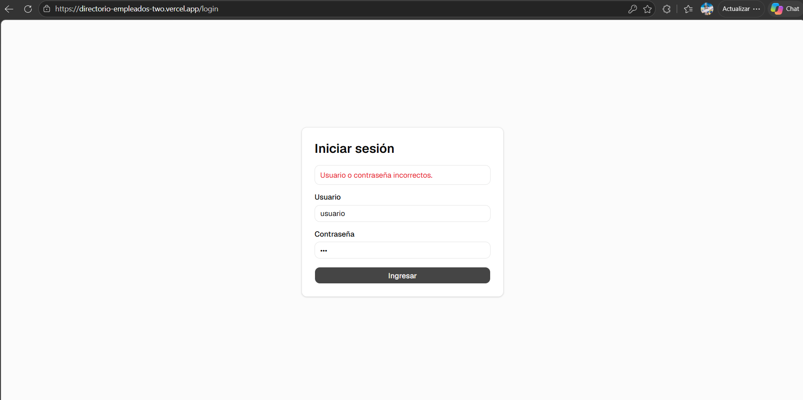
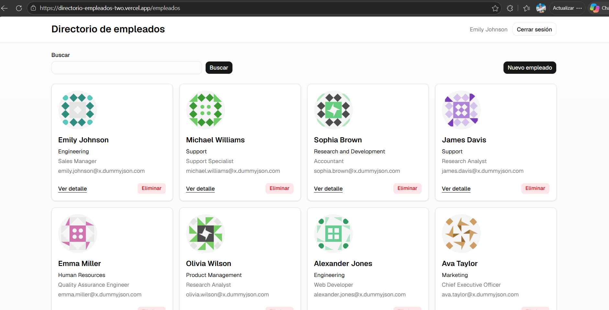
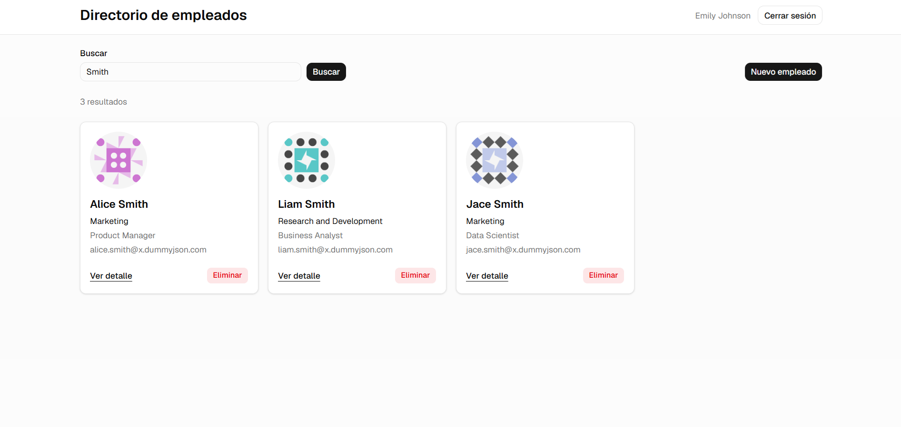
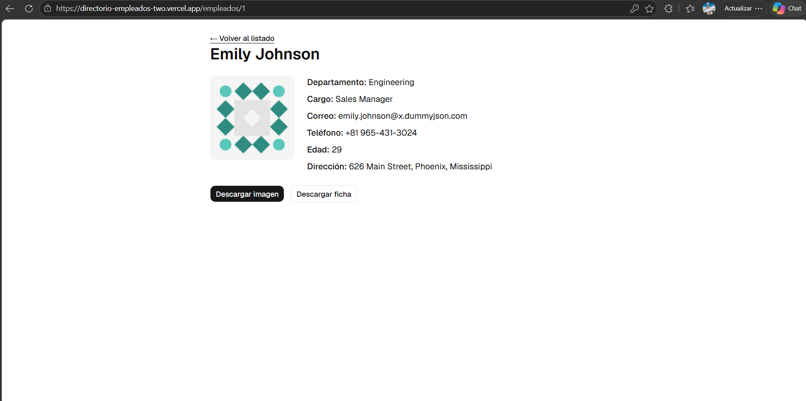
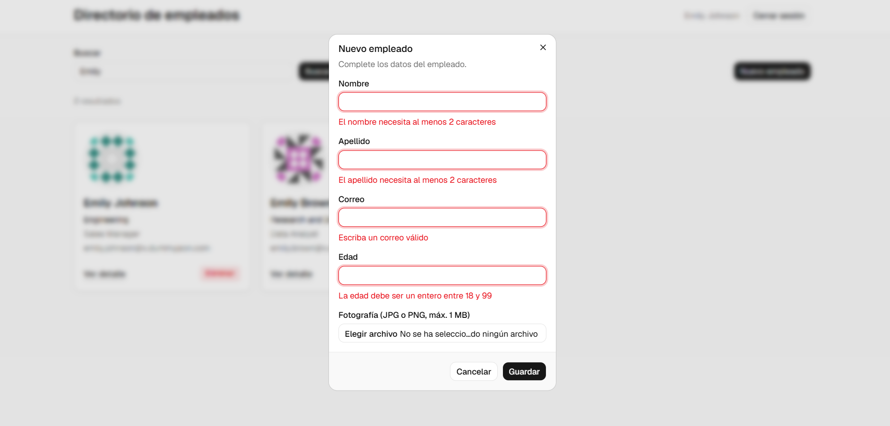
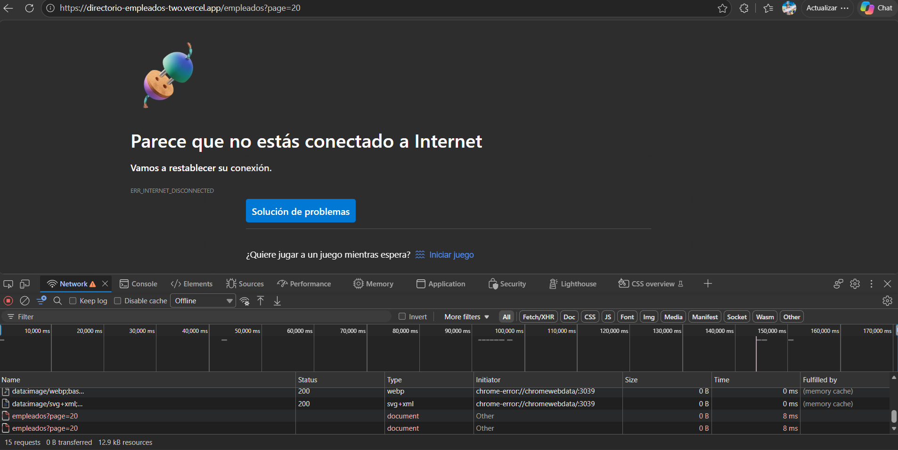

# Directorio de empleados

Aplicación web para consultar el directorio de empleados de una empresa. Permite iniciar sesión, ver el listado paginado, buscar por nombre, abrir la ficha de un empleado, descargar su fotografía y su ficha, dar de alta a un empleado con fotografía y darlo de baja. Los datos provienen de la API pública DummyJSON, que simula las altas y las bajas sin guardarlas.

Proyecto de recuperación del curso Desarrollo Web (036), Universidad Mariano Gálvez, Centro Universitario de Chiquimulilla.

Sitio desplegado: PENDIENTE

## Instalación y ejecución

```bash
git clone https://github.com/jrivasp9-cpu/directorio-empleados.git
cd directorio-empleados
npm install
npm run dev
```

La dirección de la API se lee de VITE_API_URL. Si no existe, usa https://dummyjson.com. Hay un archivo .env.example como modelo.

Cuenta de prueba de la API: usuario emilys, contraseña emilyspass.

## Scripts

npm run dev inicia el servidor de desarrollo.
npm run build genera la versión de producción.
npm run lint revisa el código con ESLint.

## Tecnologías

React 19, TypeScript, Vite, Tailwind CSS, shadcn/ui, React Router, Zustand, TanStack Query, Axios, React Hook Form, Zod y react-hot-toast.

## Capturas

Inicio de sesión con credenciales incorrectas



Directorio con la paginación



Búsqueda con resultados



Detalle de un empleado



Formulario con un error de validación



Tarjeta de error con el botón Reintentar

